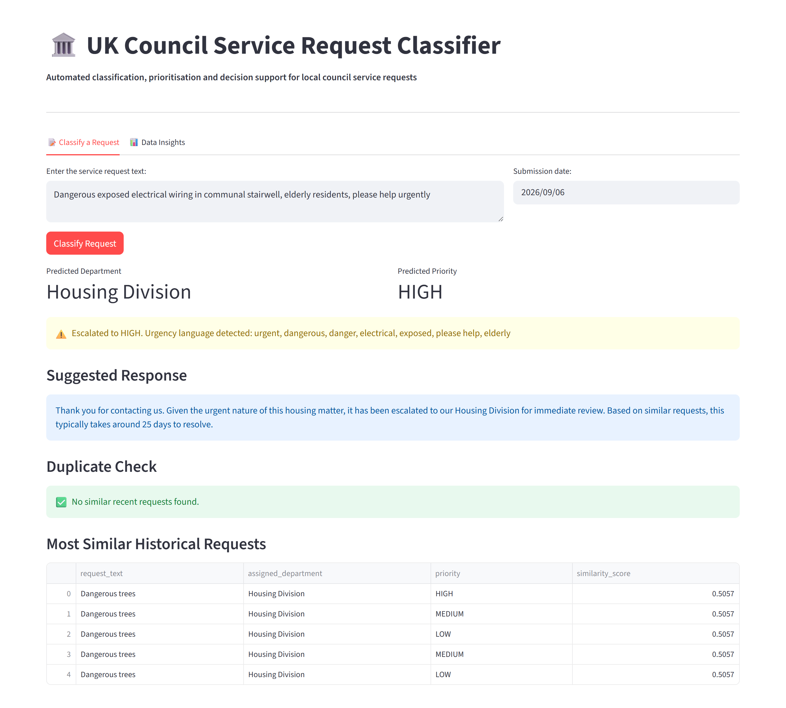
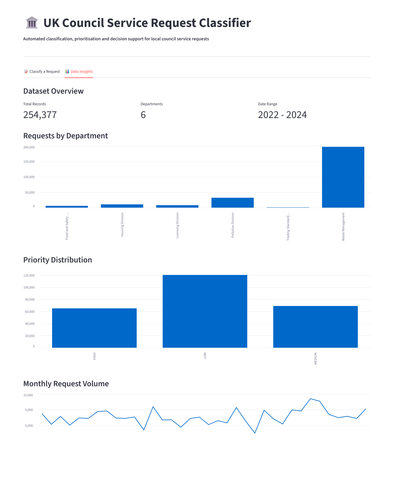
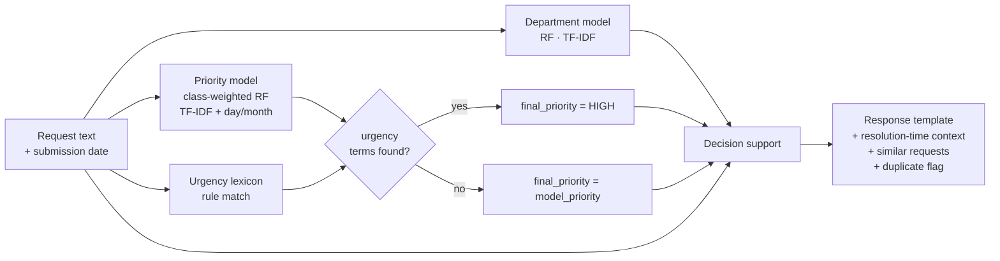
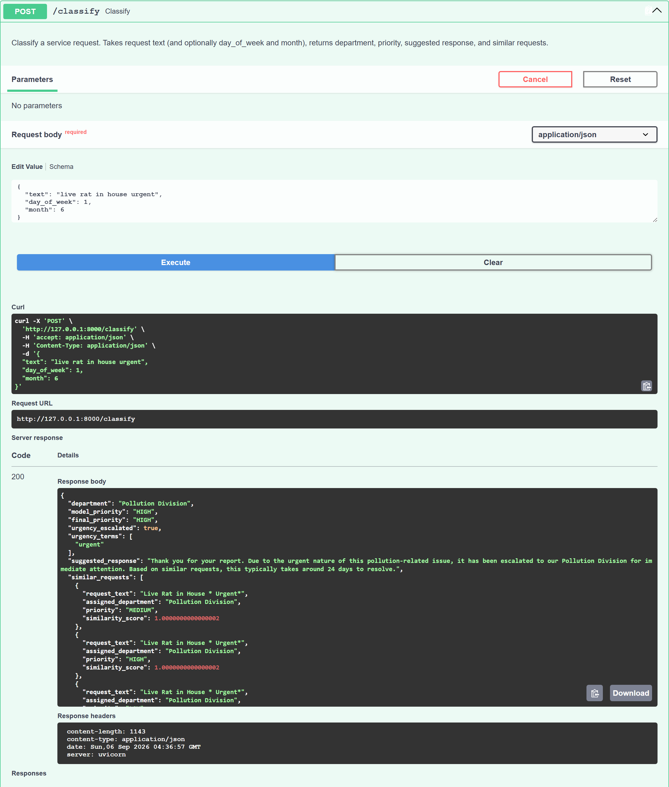
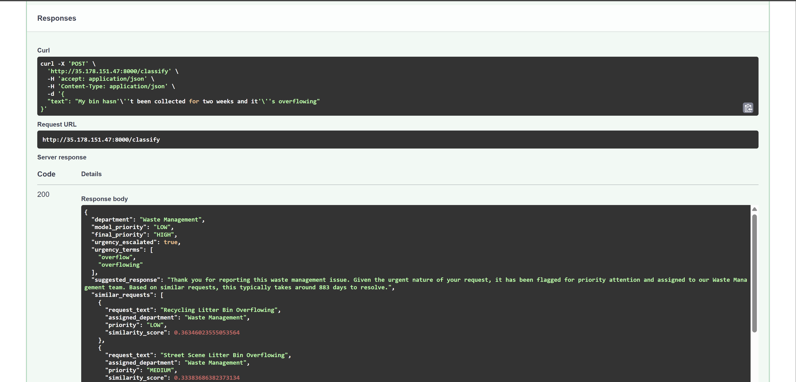

# Council Classifier

**Machine learning for automated triage of UK local council service requests:** predicting the
handling department and priority of an incoming request, then generating a suggested response,
historical resolution-time context and a duplicate-request check.

A portfolio project built on three years of Swansea Council Freedom of Information data. It
covers the full lifecycle: data exploration, model development across two prediction tasks, a
hybrid ML and rule-based urgency layer, a decision-support layer, a Streamlit dashboard, and a
containerised FastAPI service deployed to AWS ECS Fargate.

[](https://github.com/OutisAyo/council-classifier/actions/workflows/ci.yml)

[](LICENSE)

---

## Highlights

| | |
|---|---|
| **Task 1: department classification** | 6 classes, Random Forest, **F1-macro 0.992** |
| **Task 2: priority classification** | 3 classes, class-weighted Random Forest with TF-IDF and temporal features, **F1-macro 0.65**, HIGH-priority recall lifted from 0.34 to 0.63 |
| **Hybrid urgency layer** | Transparent rule-based override on top of the ML model, catching urgency language too rare (0.12% of records) to learn from directly |
| **Decision support** | Department and priority aware response templates, TF-IDF retrieval of similar historical requests, and duplicate detection |
| **Serving** | FastAPI `/classify` endpoint, Docker image, deployed on AWS ECS Fargate; Streamlit dashboard for interactive use |

---

## Dashboard

The Streamlit dashboard (`dashboard/app.py`) wraps the same prediction code that backs the API.





## Problem

UK local councils receive large volumes of free-text service requests (missed bins, pest
control, noise, housing, food safety, trading standards). Each has to be routed to the right
team and prioritised. Doing this manually is slow and inconsistent. This project asks how far
a model trained only on the information available *at the point a request is filed* can
automate that triage.

## Dataset

Swansea Council FOI release covering **2022-2024**: category code, complaint-type code,
assigned department, and received / target / closed dates.

| Stage | Rows |
|---|---|
| Raw | 260,286 |
| After dropping two under-represented departments (Administration, Building Control) | 260,237 |
| After removing rows without a derivable priority label | **254,377** |

**Departments (6):** Waste Management (78%), Pollution Division, Housing Division, Licensing
Division, Food and Safety Division, Trading Standards Division. The classes are heavily
imbalanced, so **F1-macro is the headline metric** throughout.

**Priority label** is derived from resolution time (`date_closed` minus `date_received`):

| Priority | Definition | Share |
|---|---|---|
| HIGH | closed within 1 day | 25.6% |
| MEDIUM | closed within 2 to 7 days | 27.1% |
| LOW | took more than 7 days | 47.3% |

The raw dataset is **not redistributed here**. See [`models/README.md`](models/README.md) for how
to obtain the trained artifacts, or run the notebooks against your own copy of the source data.

## Approach



### Task 1: department classification (notebooks 03-07)

Naive Bayes, Logistic Regression, Random Forest and XGBoost were compared on a stratified
hold-out set. **Random Forest** won on F1-macro (0.9921) and was selected. Diagnostic analysis
showed the task is largely solved by category vocabulary alone: 99.9% of records come from
category codes with over 90% single-department dominance, which is why more sophisticated
models gave diminishing returns.

### Task 2: priority classification (notebooks 08-18)

Much harder: the same four algorithms all plateaued around 0.61 F1-macro with HIGH-priority
recall stuck near 0.34. Feature-importance diagnostics revealed why: the standardised
staff-assigned category codes carry almost none of the urgency signal that would sit in
original citizen-submitted text. A sequence of targeted enhancements followed:

| Stage | F1-macro | HIGH recall |
|---|---|---|
| Baseline (Naive Bayes) | 0.590 | 0.34 |
| Best base model (Random Forest) | 0.610 | 0.34 |
| + class weighting | 0.620 | 0.45 |
| + TF-IDF and n-grams | 0.620 | 0.45 |
| **+ temporal features (day-of-week, month)** | **0.653** | **0.63** |
| + department feature and Grid-Search tuning (nb 17) | 0.655 | 0.59 |

Temporal features were the turning point. The production pipeline
(`priority_pipeline_final.pkl`) is **TF-IDF (1 to 2 grams) + day-of-week + month +
class-weighted Random Forest**, wrapped in a single scikit-learn `ColumnTransformer` pipeline.
`date_closed` is never used as an input, only information available when the request is filed.

### Hybrid urgency layer (notebook 18)

Explicit urgency language ("urgent", "dangerous", "no water", "elderly") appears in only
**0.12%** of records, far too sparse to train on. Instead a hand-built lexicon in three
categories (*explicit*, *hazard*, *distress*) is checked against each request; any match
escalates `final_priority` to HIGH regardless of the model output. The response always reports
**which** terms triggered the escalation, keeping the decision auditable, a common pattern in
real triage systems.

### Decision-support layer (notebook 15)

- **Response templates:** one per (department by priority), e.g. a HIGH Pollution Division
  request gets an escalation-worded acknowledgement.
- **Retrieval context:** the incoming request is TF-IDF-vectorised and cosine-matched against
  all 254k historical requests; the average resolution time of the closest matches is appended
  to the response ("this typically takes around 24 days to resolve").
- **Duplicate detection:** flags when a near-identical request was filed in the last 7 days,
  a proxy for multiple citizens reporting the same underlying issue.

## Repository structure

```
council-classifier/
├── app/                     FastAPI service
│   ├── main.py              routes: /health, /classify
│   ├── schemas.py           Pydantic request/response models
│   ├── models.py            lazy singleton that loads all artifacts once
│   └── predictor.py         end-to-end prediction + decision support
├── dashboard/
│   └── app.py               Streamlit UI (classification + data insights)
├── notebooks/               01-18, the full development narrative
├── models/                  *.pkl artifacts, stored via Git LFS (see models/README.md)
├── tests/                   pytest suite (schema + API)
├── Dockerfile
├── Makefile
├── requirements.txt         API runtime deps
├── requirements-dev.txt     test + lint deps
└── notebooks/requirements.txt
```

## Getting started

```bash
git clone https://github.com/OutisAyo/council-classifier.git
cd council-classifier

# the trained pipelines (~200 MB) are stored with Git LFS
git lfs install
git lfs pull

python -m venv venv
source venv/bin/activate          # Windows: venv\Scripts\activate
pip install -r requirements.txt
```

With Git LFS installed before cloning, the `git clone` fetches the models for you;
`git lfs pull` (or `make models`) is only needed if LFS was set up afterwards.

### Run the API

```bash
uvicorn app.main:app --reload
```

Interactive docs at <http://127.0.0.1:8000/docs>. Example call:

```bash
curl -s -X POST http://127.0.0.1:8000/classify \
  -H "Content-Type: application/json" \
  -d '{"text": "live rat in house urgent", "day_of_week": 1, "month": 6}'
```

```jsonc
{
  "department": "Pollution Division",
  "model_priority": "HIGH",
  "final_priority": "HIGH",
  "urgency_escalated": true,
  "urgency_terms": ["urgent"],
  "suggested_response": "Thank you for your report. Due to the urgent nature of this pollution-related issue, it has been escalated to our Pollution Division for immediate attention. Based on similar requests, this typically takes around 24 days to resolve.",
  "similar_requests": [
    { "request_text": "Live Rat in House * Urgent*", "assigned_department": "Pollution Division", "priority": "HIGH", "similarity_score": 1.0 }
  ]
}
```

The same call in the interactive Swagger docs at `/docs`:



### Run the dashboard

```bash
pip install -r notebooks/requirements.txt   # provides streamlit + plotting deps
streamlit run dashboard/app.py
```

### Docker

```bash
docker build -t council-classifier .
docker run -p 8000:8000 council-classifier
```

The image copies `models/` in at build time, so run `git lfs pull` first.

### Deployment

The image was pushed to Amazon ECR and run as an **AWS ECS Fargate** service with a public
IP, reachable directly on port 8000, as a cloud-deployment learning exercise. The same image
runs unchanged locally, on Fargate, or on any container host.

`POST /classify` served from the Fargate task:



## Tech stack

Python 3.11 · scikit-learn 1.6 · XGBoost · pandas / NumPy · FastAPI · Pydantic v2 · Uvicorn ·
Streamlit · Docker · AWS ECR + ECS Fargate · pytest · Ruff · GitHub Actions

## Limitations and future work

- **Priority ceiling.** ~0.65 F1-macro reflects a genuine information limit: the FOI extract
  contains staff-assigned codes, not raw citizen text. Access to original request wording
  would be the single biggest improvement.
- **Proxy label.** "Priority" is inferred from historical resolution time, which also encodes
  team capacity and backlog, not just true urgency.
- **Urgency lexicon** is hand-curated and English-only; it would need review with council
  staff and periodic updating before real use.
- **No online learning.** Models are static and would need scheduled retraining as request
  patterns shift.
- Retrieval and duplicate checks run in-process against the full dataset; a production version
  would move these to a vector store.

## Author

**Fashina Fuad Ayomide** ([@OutisAyo](https://github.com/OutisAyo))

## License

[MIT](LICENSE)
